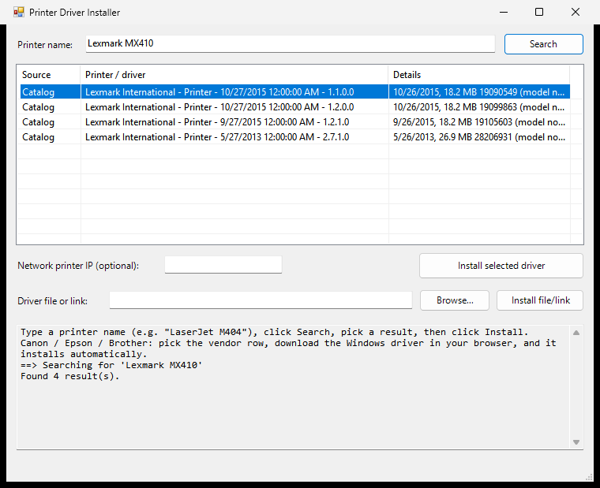
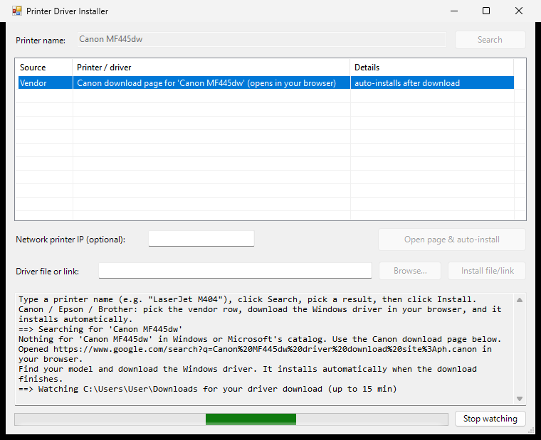
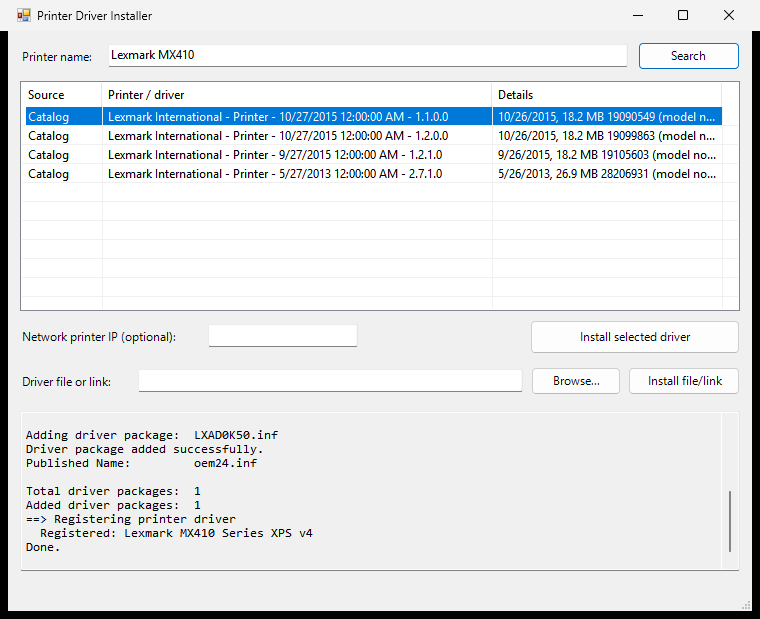

<p align="center"></p>

# Printer Driver Installer

A Windows tool that finds a printer driver from the printer's name and installs it with no
Next / Accept clicks. It searches the drivers already on the PC, the ones built into Windows and
Microsoft's Update Catalog. For Canon, Epson and Brother it opens the vendor's support page for your
model, watches your Downloads folder, and installs the file as soon as the download finishes.

PowerShell + Windows Forms (a small C# launcher builds the optional single `.exe`).

| Search | Vendor download, watching Downloads | Install log |
|---|---|---|
|  |  |  |

## Use

Double-click **`Install-PrinterDriver.bat`**. A window opens:

1. Type the printer name (for example `LaserJet M404`) and click **Search**.
2. Click the result you want.
3. (Optional) type the printer's IP address if it is a network printer.
4. Click **Install selected driver**.

Windows asks for administrator rights once, when the window opens.

Command line (same engine):

```powershell
.\Install-PrinterDriver.ps1 "Canon MF445dw" -PrinterIP 192.168.1.50 -Yes
```

Keep `Install-PrinterDriver-GUI.ps1`, `Install-PrinterDriver.ps1`, `PrinterDriverLib.ps1` and
`vendors.json` in the same folder.

## Where it looks

1. Drivers already installed on the PC.
2. Drivers built into Windows.
3. Microsoft Update Catalog: only Windows 10/11 printer packages are listed. Packages whose title has
   no model name (HP, newer Lexmark) are listed after the exact matches; only a model that matches
   what you typed is registered.
4. Canon, Epson, Brother: a vendor row at the end of the list (see below).

After a driver is added to the Windows driver store, the tool registers the matching model by name
so it shows up as a printer driver, and can create a network printer from an IP address.

## Canon, Epson and Brother

Select the vendor row and click **Open page & auto-install**:

1. Your browser opens a search for your model, limited to the vendor's support site. The tool starts
   watching your Downloads folder for 15 minutes (**Stop watching** cancels).
2. You download the Windows driver in the browser.
3. When the file finishes, the tool checks it is signed by the real vendor, unpacks the driver files
   and installs them with no installer wizard.

Auto-install handles `.exe`, `.msi` and `.cab`. A `.zip` has no signature, so use **Browse...** and
**Install file/link** for it, or for a file you downloaded earlier:

```powershell
.\Install-PrinterDriver.ps1 "Brother DCP-T420W" -Package "C:\Users\you\Downloads\driver.exe"
```

The tool does not click through the vendors' sites for you. They change often, have no public search,
and Epson's file server refuses scripted downloads, so you choose and download the file.

Vendor `.exe` installers are unpacked with the lightest method that works: as a zip archive, then by
finding CAB archives packed inside, then with 7-Zip (found in its install folder, or installed once
through `winget`). Only if none works does the tool run the vendor's own installer.

## Safety

- Catalog downloads come only from `*.windowsupdate.com` / `*.microsoft.com` and must carry a valid
  Microsoft signature.
- Vendor files must carry a valid signature from Microsoft or a publisher listed in `vendors.json`.
  Links must be `https` and on a listed vendor site.
- Zip archives are unpacked with a path check (no files outside the target folder). A `.zip` is never
  auto-installed.
- Auto-install only picks up files that appear after you click, and never runs an unsigned file.
- Windows itself still refuses unsigned drivers.

Trusted publishers, allowed download sites and each vendor's support page (set to the Philippines)
live in `vendors.json`. Edit the `supportUrl` lines for another country.

## Tests

```powershell
.\tests\Test-PrinterDriverLib.ps1            # 55 checks, uses the live Update Catalog
.\tests\Test-PrinterDriverLib.ps1 -Offline   # 45 checks, no network
```

The checks change nothing on the PC: vendor matching, the https and host allow-list, signature checks
(unsigned, wrong publisher, tampered, genuine), zip-slip, CAB carving from inside an `.exe`, `.inf`
parsing and the catalog parser.

Real installs need administrator rights, so they were tested by hand. Installing and then removing
every added package left the driver store unchanged for:

- **Brother** DCP-T420W (signed `.exe`, unpacked with 7-Zip) and **Epson** L3210 (signed `.exe`,
  unpacked as a zip), both downloaded in a browser and picked up by the watcher.
- **Lexmark** MX410, **Kyocera** FS-1040 and **HP** LaserJet Pro M404, from the Microsoft catalog.

Not tested: Canon.

## Limits

- A model is registered by name only if the package lists it. Otherwise the driver is still added to
  the driver store, and Windows uses it when the printer is plugged in.
- The "built into Windows" list is short on current Windows 11.
- Searches work best with short names ("LaserJet M404", not the full marketing name).
- The Update Catalog page is parsed without an official API, so Microsoft changing it could break
  catalog search. The installed and built-in sources are unaffected.
- USB printers: after the driver is installed, plug the printer in and Windows finishes setup.

## One file / one exe

`onefile/` has everything merged into a single script, plus a way to make a single `.exe`:

- `onefile/PrinterDriverInstaller.ps1`: the whole tool in one file (right-click, Run with PowerShell).
- `onefile/Build-Exe.bat` + `Launcher.cs`: double-click `Build-Exe.bat` to produce
  `PrinterDriverInstaller.exe`, with the script embedded. It uses the compiler that ships with
  Windows, so nothing needs installing.

The exe asks for administrator rights once, unpacks the script into `C:\ProgramData` (a folder normal
users cannot modify), runs it, and deletes it when you close the window.

Rebuild the single script after changing the sources: `python tools/build_single.py`.

An unsigned `.exe` usually makes Windows SmartScreen show a warning. Click **More info > Run anyway**.
Removing the warning needs a paid code-signing certificate.
